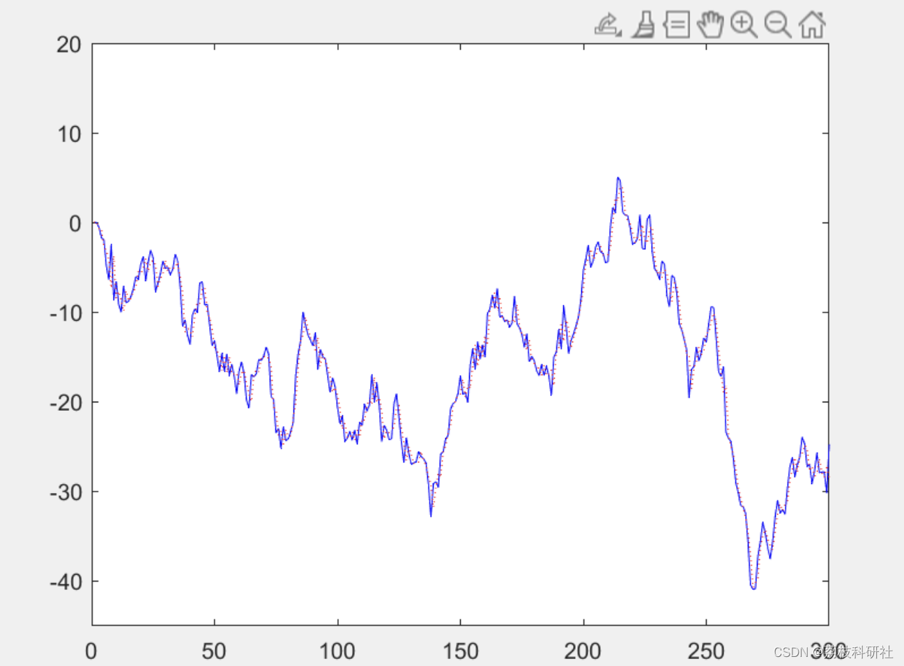
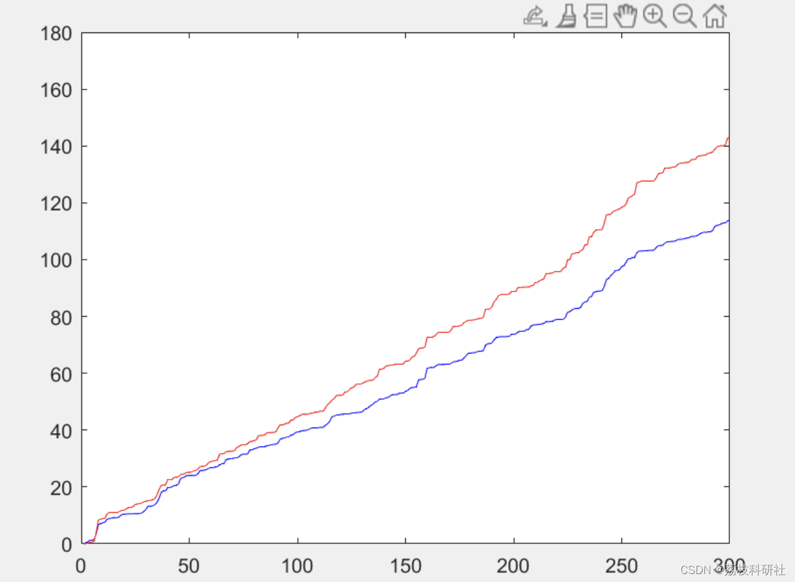
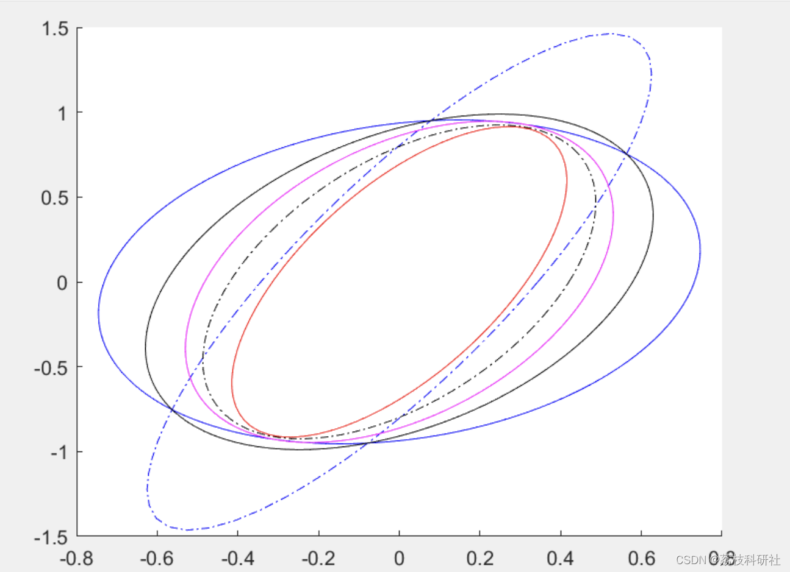
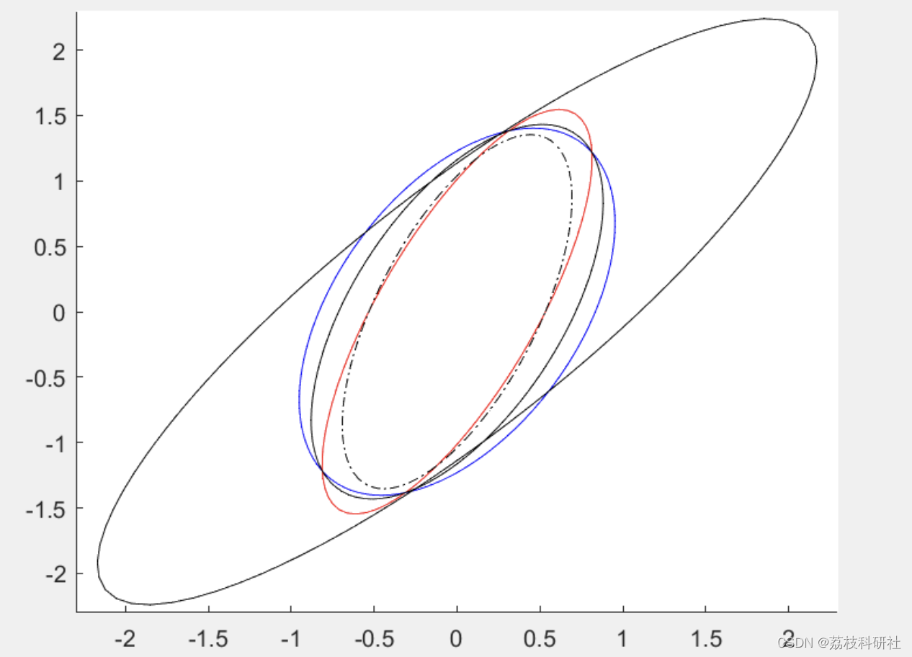
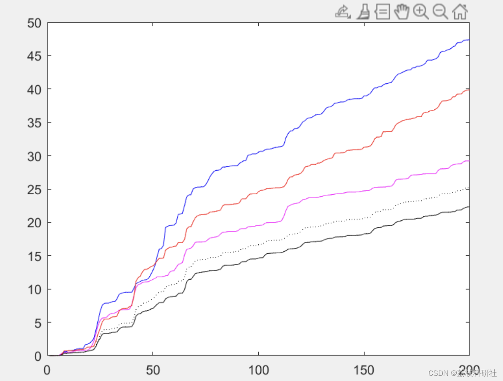
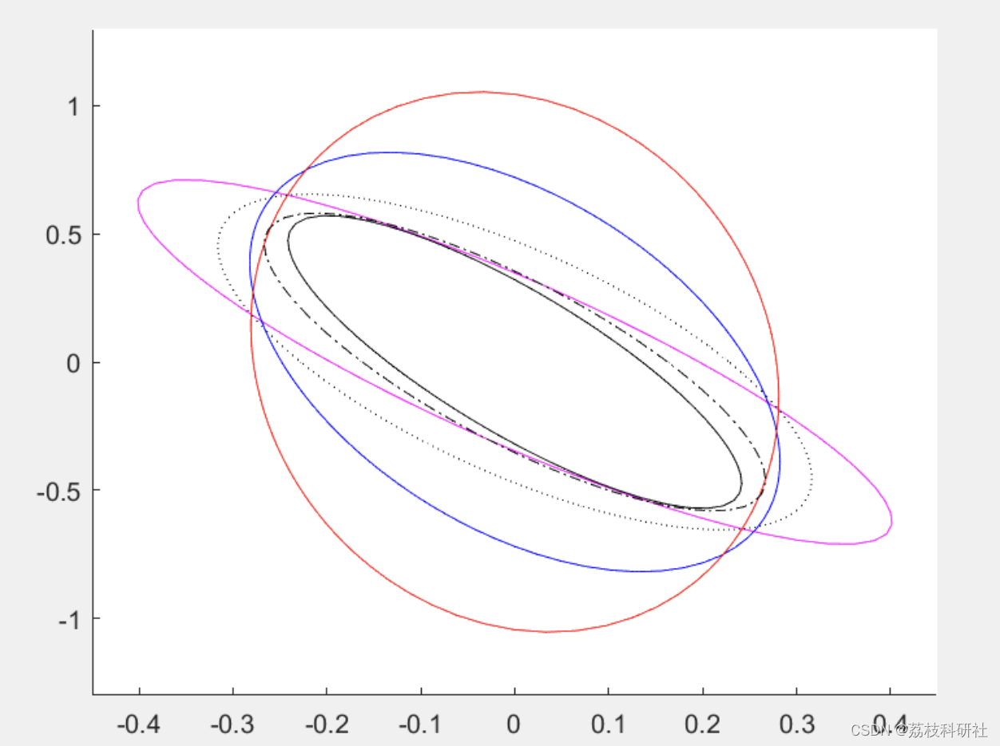
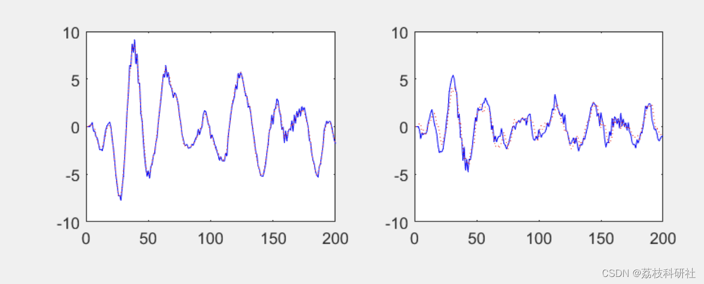
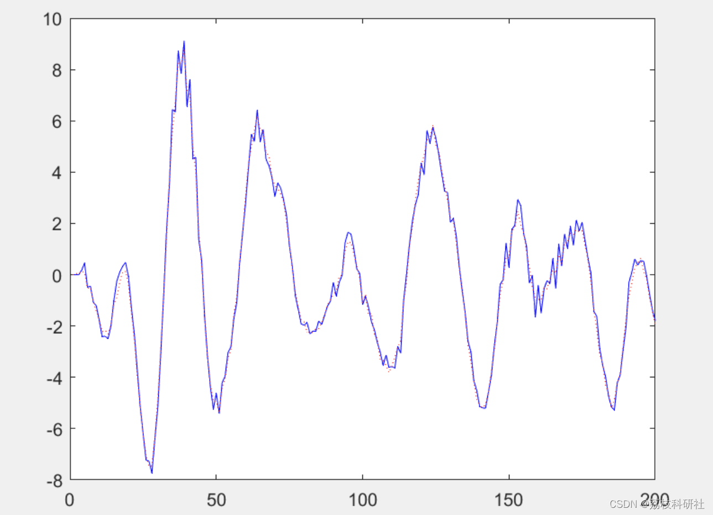

# State Estimation in Multi-Level Multi-Sensor Information Fusion (Matlab Code Implementation)

This article mainly focuses on multi-sensor and multi-delay (including state delay and observation delay) systems. It adopts Kalman filtering and modern time series analysis methods, and realizes the fusion estimation of states using centralized fusion estimation, distributed fusion estimation (by matrix weighting, by diagonal matrix weighting, by scalar weighting), and covariance cross-fusion methods.
📚2 Run results editing
​Edit
​Edit
​Edit
​Edit
​Edit
​Edit
​Edit
Part of the code:
%------------------Local Kalman Filter---------------%
%---------------------Sensor 1----------------%
PP1(:,:,1)=0.1*eye(2);P1(:,:,1)=0.1*eye(2);x1jian(:,1)=zeros(2,1);
for i=1:Bushu+5
PP1(:,:,i+1)=fai* P1(:,:,i)*fai'+gama*Qw*gama';% Forecast error variance matrix
Qeps1(i+1)=H01*PP1(:,:,i+1)*H01'+Rv1;  
k1(:,i+1)=(PP1(:,:,i+1)*H01')*inv(Qeps1(i+1));  
P1(:,:,i+1)=PP1(:,:,i+1)-k1(:,i+1)*Qeps1(i+1)*k1(:,i+1)';% Fusion error variance matrix
x1jianp(:,i+1)=fai*x1jian(:,i);% Forecast
eps1(i+1)=y1(i+1)-H01*x1jianp(:,i+1);
x1jian(:,i+1)=x1jianp(:,i+1)+k1(:,i+1)*eps1(i+1);% Filtering
end  
% t=1:Bushu;  
% figure  
% subplot(2,2,1);plot(t,x(1,t),'b',t,x1jian(1,t),'r:');  
% subplot(2,2,2);plot(t,x(2,t),'b',t,x1jian(2,t),'r:');  
%-----------------Sensor 2----------------%
PP2(:,:,1)=0.1*eye(2);P2(:,:,1)=0.1*eye(2);x2jian(:,1)=zeros(2,1);  
for i=1:Bushu+5  
PP2(:,:,i+1)=fai*P2(:,:,i)*fai'+gama*Qw*gama';%Forecast error variance matrix
Qeps2(i+1)=H12*P2(:,:,i)*H12'+Rv2;  
k2(:,i+1)=(fai*P2(:,:,i)*H12')*inv(Qeps2(i+1));  
P2(:,:,i+1)=PP2(:,:,i+1)-k2(:,i+1)*Qeps2(i+1)*k2(:,i+1)'; % Filtering error variance matrix
x2jianp(:,i+1)=fai*x2jian(:,i);%forecast
eps2(i+1)=y2(i+1)-H12*x2jian(:,i);  
x2jian(:,i+1)=x2jianp(:,i+1)+k2(:,i+1)*eps2(i+1);% Filtering
end  
% t=1:Bushu;  
% figure  
% subplot(2,2,1);plot(t,x(1,t),'b',t,x2jian(1,t),'r:');  
% subplot(2,2,2);plot(t,x(2,t),'b',t,x2jian(2,t),'r:');  
%-----------------Sensor 3----------------%
PP3(:,:,1)=0.1*eye(2);P3(:,:,1)=0.1*eye(2);x3jian(:,1)=zeros(2,1);  
for i=1:Bushu+5  
PP3(:,:,i+1)=fai*P3(:,:,i)*fai'+gama*Qw*gama';%Forecast error variance matrix
Qeps3(i+1)=H03*PP3(:,:,i+1)*H03'+H13*P3(:,:,i)*H13'+H03*fai*P3(:,:,i)*H13'+H13*P3(:,:,i)*fai'*H03'+Rv3;  
k3(:,i+1)=(PP3(:,:,i+1)*H03'+fai*P3(:,:,i)*H13')*inv(Qeps3(i+1));  
P3(:,:,i+1)=PP3(:,:,i+1)-k3(:,i+1)*Qeps3(i+1)*k3(:,i+1)';% Filtering error variance matrix
x3jianp(:,i+1)=fai*x3jian(:,i);%forecast
eps3(i+1)=y3(i+1)-H03*x3jianp(:,i+1)-H13*x3jian(:,i);  
x3jian(:,i+1)=x3jianp(:,i+1)+k3(:,i+1)*eps3(i+1);% Filtering
end  
% t=1:Bushu;  
% figure  
% subplot(2,2,1);plot(t,x(1,t),'b',t,x3jian(1,t),'r:');  
% subplot(2,2,2);plot(t,x(2,t),'b',t,x3jian(2,t),'r:');  
%-----------------trace----------------%
for i=1:Bushu+5  
a(i)=trace(P1(:,:,i));  
b(i)=trace(P2(:,:,i));  
c(i)=trace(P3(:,:,i));  
end  
%-----------------Filtering Error Covariance Matrix----------------%
P12(:,:,1)=eye(2);P13(:,:,1)=eye(2);P23(:,:,1)=eye(2);  
for i=1:Bushu  
PP12(:,:,i+1)=fai* P12(:,:,i)*fai'+gama*Qw*gama';%Forecast error mutual covariance matrix
PP13(:,:,i+1)=fai* P13(:,:,i)*fai'+gama*Qw*gama';  
PP23(:,:,i+1)=fai* P23(:,:,i)*fai'+gama*Qw*gama';  
%---Filtering Error Covariance Matrix----%
P12(:,:,i+1)=[eye(2)-k1(:,i+1)*H01]*PP12(:,:,i+1)-[eye(2)-k1(:,i+1)*H01]*fai*P12(:,:,i)*H12'*k2(:,i+1)';P21(:,:,i+1)=P12(:,:,i+1)';  
P13(:,:,i+1)=[eye(2)-k1(:,i+1)*H01]*PP13(:,:,i+1)*[eye(2)-k3(:,i+1)*H03]'-[eye(2)-k1(:,i+1)*H01]*fai*P13(:,:,i)*H13'*k3(:,i+1)';P31(:,:,i+1)=P13(:,:,i+1)';  
P23(:,:,i+1)=PP23(:,:,i+1)*[eye(2)-k3(:,i+1)*H03]'+k1(:,i+1)*H12*P23(:,:,i)*H13'*k3(:,i+1)'-fai*P23(:,:,i)*H13'*k3(:,i+1)'-k2(:,i+1)*H12*P23(:,:,i)*fai'*[eye(2)-k3(:,i+1)*H03];P32(:,:,i+1)=P23(:,:,i+1)';  
end  
%-----------------Weighted by Matrix---------------%
for i=1:Bushu  
Psigma(:,:,i)=[P1(:,:,i),P12(:,:,i),P13(:,:,i);  
P12(:,:,i)',P2(:,:,i),P23(:,:,i);  
P13(:,:,i)',P23(:,:,i)',P3(:,:,i)];  
end  
e=[eye(2),eye(2),eye(2)]';  
for i=1:Bushu  
A(:,:,i)=inv(Psigma(:,:,i))*e*inv(e'*inv(Psigma(:,:,i))*e);  
Pf(:,:,i)=inv(e'*inv(Psigma(:,:,i))*e);% Error variance matrix
xfjian(:,i)=A(1:2,:,i)'*x1jian(:,i)+A(3:4,:,i)'*x2jian(:,i)+A(5:6,:,i)'*x3jian(:,i);  
end  
% t=1:Bushu;  
% figure  
% subplot(2,2,1);plot(t,x(1,t),'b',t,xfjian(1,t),'r:');  
% subplot(2,2,2);plot(t,x(2,t),'b',t,xfjian(2,t),'r:');  
%-----------------exf---------------%  
exf(300)=[0];  
exf(1)=(xfjian(1,1)-x(1,1))*(xfjian(1,1)-x(1,1));  
for i=2:Bushu  
exf(i)=(xfjian(1,i)-x(1,i))*(xfjian(1,i)-x(1,i))+exf(i-1);  
end  
% t=1:Bushu;  
% figure  
% subplot(2,2,1);plot(t,exf(1,t),'b');  
% subplot(2,2,2);plot(t,exf(2,t),'b');  
%-----------------BCI----------------%  
f=f_bcifun(w);  
Aeq=[1 1 1];Beq=[1]; LB=[0 0 0]';UB=[1 1 1]';A=[];B=[];  
w0=[0.4;0.4;0.2];  
w=fmincon(@f_bcifun,w0,A,B,Aeq,Beq,LB,UB)  
PBci = inv(w(1)*inv(P1(:,:,Bushu)) + w(2)*inv(P2(:,:,Bushu)) + w(3)*inv(P3(:,:,Bushu))); % CI fusion valuation error variance matrix
JBci = trace(PBci);%Trace of the trace of CI fusion valuation error variance matrix.
for i=1:Bushu  
xBci(:,i)=PBci*(w(1)*inv(P1(:,:,Bushu))*x1jian(:,i)+w(2)*inv(P2(:,:,Bushu))*x2jian(:,i)+w(3)*inv(P3(:,:,Bushu))*x3ji  
🎉3 References
🌈4 Matlab code implementation

## Images

<!-- PAYMENT_BLOCK -->

## Get this dataset

- Payment link (Stripe): [Buy now](https://buy.stripe.com/3cs8yP7sY87d0vu9AB)
- Payment QR code: 

<!-- /PAYMENT_BLOCK -->
